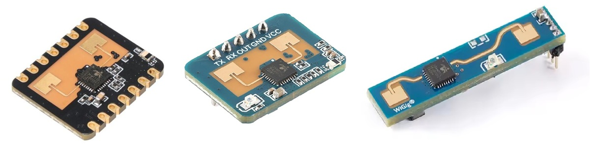
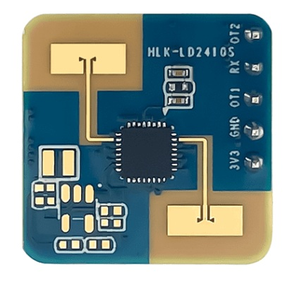
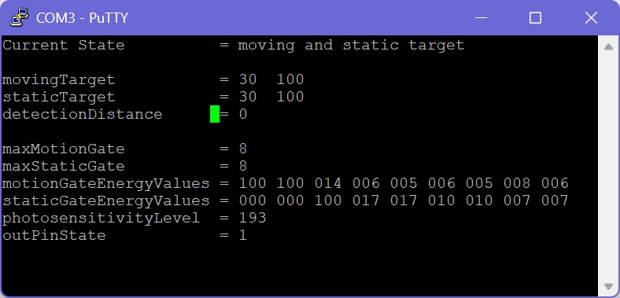

# Arduino library for LD2410C and LD2410B 24GHz mmWave Sensors

There are (at least) three versions of the LD2410 sensor module. The LD2410B, LD2410C and LD2410S. This library is for the LD2410B and LD2410C versions. The LD2410S has a different communications protocol, so use the [LD2410SmmWave Library](https://github.com/mumnachu/LD2410SmmWave) for that one.



The pictures above, left to right,

* 24Ghz mmWave Human Static Presence Sensor for Seeed Studio XIAO, SKU 101010001 (VCC = 3.3V)
* HLK-2410C (VCC = 5V)
* HLK-2410B (VCC = 5V)

The Seeed Studio XIAO board has a Bluetooth antenna and can use a mobile phone application for configuration, which is nice. The other two boards can use a Chinese application (not Digitally Signed) for configuration, but I'm a bit dubious about that one, the download file size is enormous (what's in there?).

All modules use the same S3KM1110 mmWave chip.

> [!CAUTION]
> The XIAO board is powered by 3.3V and can be used _only_ with 3.3V MCUs. \
> The HLK-2410C and B boards are powered powered by 5V (they have 3.3V onboard regulators). However, the RX/TX and GPIO signals are 3.3V, so they _can_ be used safely with both 5V and 3.3V microcontrollers. 

The picture below is the LD2410S board, which needs the [LD2410SmmWave Library](https://github.com/mumnachu/LD2410SmmWave). This is a nice board, and it is more common and cheaper than the others.



<br/>


Now follows a summary of the LD2410's features, so you don't have to read the manual.


## Configurable Baud Rate

The default serial port clock speed is fast, 256000bps. This is fine for `HardwareSerial` (or `Uart`), but if you want to use a `SoftwareSerial` port then you must reduce this to 9600, 19200 or 38400, depending on the speed of your MCU.

Do this by calling `setBaudRate(baudRateIndex)` followed by `restartModule()` or power-up. Don't forget to modify `Serial1.begin(speed)` for the new baud rate.

The original baud rate can be restored with `restoreFactorySettings()` or `setBaudRate(256000)`, also followed by `restartModule()` or power-up.

If you have long RX/TX wires, then you should also use a slower speed to improve reliability.

> [!NOTE]
> "Baud rate" and "bits-per-second" (clock speed) are not the same thing. When people refer to the "Baud rate", they usually mean the clock speed in bits-per-second. The Baud rate is the number of actual _data bits_ sent per second, which EXCLUDES the start, stop and parity bits and incorporates the delay between each byte and each message. So a "bits-per-second" speed of 9600 (with 1 start, 1 stop and 1 parity bit, 8E1) is actually a maximum Baud rate of about 6980, or 870 bytes per second, assuming there are no delays between bytes and between messages.


## Configuration Mode and Radar Data Report Mode

The programmed settings are stored in nonvolatile memory, so they only need to be programmed once. This can be done using this library, with the PC application , or the Bluetooth phone app (XIAO version only).

To configure the sensor with this library, you must first put it into _Configuration Mode_ with `enableConfigurationMode()`. This stops the radar data output and puts it into a mode ready to receive commands. The library does not do this for you. Some libraries enable/disable Configuration Mode for every command, but that's not very efficient if you want to send multiple commands.

After calling `LD2410mmWave.begin()`, the sensor is already in _Configuration Mode_.

Use `disableConfigurationMode()` to end configuration mode and resume radar data transmissions.


## Radar Data Report Mode : Standard and Engineering Data Reports

When not in _Configuration mode_, the sensor is in _Radar Data Report Mode_ where it continously sends messages to the MCU on the TX line. These messages are polled from `loop()` by `sensor.receive(&radarData, &engineeringData)`, as shown in the example sketch.

_Engineering mode_ enables additional data to be returned in the radar messages, in the `ENGINEERINGDATA` structure. Enable this with `startEngineeringMode()`.

The _mumanchu_ library uses a real-time 'state machine' in `receive()` to parse the message as it is received and determine if it's a 'command acknowledge' message or a 'radar data' message. The state machine restarts if there are any errors in the message.


## Distance Gates

The sensor uses _distance gates_, which are time windows for the reflected radar signal. The default span of a distance gate is 0.75m. This can be set to 0.2m using `setDistanceResolution()`, which reduces the detection range to 1.6m.

Each distance gate can be programmed with its own _sensitivity_.

The S3KM1110 has up to 8 distance gates, allowing a range of 0.75 .. 6m, or 0.75 .. 1.6m, depending on the stance resolution. The maximum range can be reduced by setting the farthest (max) distance gate `setMaxGate(byte maxMotionGate, byte maxStaticGate,	short unoccupiedDelay)` for motion and static gates. `setMaxGate()` also sets the 'unoccupied' delay.


## Sensitivity

The sensitivity can be set for each gate, range 0..100, using `setGateSensitivity()`. This is the 'target energy value' needed to register a presence signal, so 0 = maximum sensitivity, 100 = no sensitivity (disables the distance gate).


## Moving and Static Targets

The sensor can detect both moving and static targets, even at the same time.

There are two sets of distance gates. 'Motion gates' for moving targets, and 'static gates' for stationary targets. The number of motion and static distance gates (the last distance gate numbers) can be set with `setMaxGate()`, and the distance gate sensitivity (energy) values can be set for each individual distance gate.


## Unoccupied Delay

The delay between the last motion or static detection and the clearing of 'presence detected' (occupied -> unoccupied) is set with `setMaxGate(..., short unoccupiedDelay)` in seconds. 

The `OUT` pin goes high when a presence (motion or static) is detected, and goes low when nothing has been detected for the `unoccupiedDelay` period.


## Output Pin

A single digital output indicates 'occupied' (moving or sationary) or 'unoccupied' (no body present). This output can be connected to a microcontroller input which can be polled, or generate an interrupt when the state changes. 

Once the mmWave chip has been configured, this signal is all you need for many applications. You don't really need the serial communications unless you want the more detailed Engineering Mode information. 


## Notes ♩ ♪ ♫ ♬

* After configuration, it is not necessary to use the serial communications unless you want to re-configure the chip or read the more detailed 'Engineering' data values. First configure it with this library, or the PC or mobile phone app. Then use the `OUT` pin for presence detection.

* The 'static gate' energy values for distance gates 0 and 1 are fixed at 0. Static distance detection starts at 1.5m, so near objects in the environment are automatically excluded.

* The 'detectionDistance' value will be 0 if the distance is too close.

* If the 'target state' changes to 'no target', the RADARDATA values do not change. They are changed only if a new target is detected.

* When running continuously in 'engineering mode', it sometimes switches out of engineering mode on its own and stops returning the additional `ENGINEERINGDATA`. The example sketch detects this and re-enables engineering mode.


## Installing the Library

In the Arduino IDE's Library Manager, search for 'mumanchu' and look for the `LD2410mmWave` library. If found, just install it from there.

If not found, or if not using the Arduino IDE, download the latest ZIP file with green button on this library's Github screen, "<> Code / Download Zip". This downloads a file called "LD2410mmWave-main.zip" into your Downloads directory.

**To install the ZIP file with the Arduino IDE** \
Select menu item "Sketch / Include Library > Add ZIP Library...". This opens the "Select ZIP File" window. Open the Downloads directory and choose the "LD2410mmWave-main.zip" file you just downloaded. You should see a "Successfully installed library" message. \
To open the example sketch, select menu item "File > Examples" and scroll down beyond "Examples from Custom Libraries" and choose the "LD2410mmWave > LD2410mmWave-Example" entry. This opens the "LD2410mmWave-Example.ino" example sketch in a new Arduino IDE window.


## Class Reference

This provides an overview of the library.

For details of each method, refer to the comments in the source code, [src/LD2410mmWave.h](src/LD2410mmWave.h).

Chapter numbers in the source code refer to this version of the data sheet, \
https://muman.ch/pub/HLK-LD2410C-serial-communication-protocol-V1.07.pdf

The library is in a single include file, not separate `.h` and `.cpp` files. This is fine if you want to access the class from a single source file, which is the usual case. If you need to access it from more than one source file, then move the code into a `.cpp` file.


```cpp
class LD2410mmWave
{
public:
    // Use 1-byte structure member packing to optimize memory usage
    #pragma pack(push)
    #pragma pack(1)

    // For readConfiguration()
    struct CONFIGDATA
    {
        byte maxGate;
        byte maxMotionGate;
        byte maxStaticGate;
        byte motionSensitivity[9];
        byte staticSensitivity[9];
        short unoccupiedDelay;
    };

    // Radar data 
    struct RADARDATA
    {
        // 0x01=engineering mode, 0x02=normal mode
        byte mode;
        // 0=no target, 1=moving target, 2=stationary target, 
        // 3=moving and stationary target, 4..6=background noise detection
        byte targetState;

        short motionTargetDistance;     // cm
        byte motionTargetEnergy;        // 0..100
        short staticTargetDistance;     // cm
        byte staticTargetEnergy;        // 0..100
        short detectionDistance;        // cm
    };

    // Additional radar data when in engineering mode
    struct ENGINEERINGDATA
    {
        byte maxMotionGate;
        byte maxStaticGate;
        byte motionGateEnergyValues[9];
        byte staticGateEnergyValues[9];
        byte photosensitivityLevel;     // this seems to do nothing
        byte outPinState;
    };

    #pragma pack(pop)    // back to default structure member packing

public:
    // this may be useful if the protocol changes, set by enableConfigurationMode()
    // at present it is always 1
    short protocolVersion;

    bool begin(Stream* stream);
    bool enableConfigurationMode();
    bool disableConfigurationMode();

    //>>> The sensor must be on Configuration Mode to use the following methods
    bool startEngineeringMode();
    bool endEngineeringMode();
    bool restoreFactorySettings();
    bool restartModule();
    bool getFirmwareVersion(char* fwVersion /*16 chars*/);
    bool getMacAddress(byte* macAddress /*6 bytes*/);
    bool getConfiguration(CONFIGDATA* configData);
    bool turnOnBluetooth(bool on);

    // Configuration methods are optional
    #ifdef LD2410_ENABLE_CONFIG

    bool setBaudRate(byte baudRateIndex);
    bool setGateSensitivity(short gate, byte motionSensitivity, byte staticSensitivity);
    bool setMaxGate(byte maxMotionGate, byte maxStaticGate, short unoccupiedDelay);
    bool setDistanceResolution(byte distanceResolutionIndex);
    bool getDistanceResolution(byte* distanceResolutionIndex);
    bool setAuxControlConfiguration(byte lightSensingControl,
        byte lightSensitivityThreshold, byte outPinLevel);
    bool getAuxControlConfiguration(byte* lightSensingControl,
        byte* lightSensitivityThreshold, byte* outPinLevel);
    bool startBackgroundNoiseDetection(short duration);
    bool queryBackgroundNoiseDetection(byte* status);
    bool enterBluetoothPassword(char* password /*6 chars + NUL*/);
    bool setBluetoothPassword(char* password /*6 chars + NUL*/);
    #ifdef DEBUG
    void dumpRadarData(RADARDATA* radarData);
    void dumpEngineeringData(ENGINEERINGDATA* radarData);
    #endif

    #endif // #ifdef LD2410_ENABLE_CONFIG
    //<<<

    bool receive(RADARDATA* radarData = NULL, ENGINEERINGDATA* engineeringData = NULL);
};
```


## Example Sketch

The example sketch uses two serial ports. `Serial` for the Serial Monitor output, and `Serial1` for communicating with the mmWave sensor. It shows how to define `Serial1` on several different MCUs.

`Serial1` must be `HardwareSerial` (or `Uart`) to support the fast 256000bps default serial speed. If you want to use `SoftwareSerial`, you must re-program the sensor for a slower baud rate, as decibed above.

It has some patched-out code to do a **factory reset**, which you can enable by changing `#if 0` to `#if 1`.

`loop()` polls for Engineering Mode report messages and displays them on the Serial Monitor. If you are using PuTTy, or a Serial Monitor which has a `clear screen` command and supports 'carriage return (\r), then you will get a nice non-scrolling display. You may need to edit the serial monitor clear screen escape sequence `"\033[H"` if you're not use PuTTY. With the Arduino Serial Monitor you will see a scrolling display because this does not support '\r' or any escape sequences.



There is a problem where the sensor regularly drops out of Engineering Mode and starts returning the shorter report messages without the additional engineering data. If this happens, the sketch automatically restarts Engineering Mode. I'm not sure why this happens.


## LD2410mmWave Library Key Points

* This (old) new library is still being maintained. If you have a query or find a bug, just email us on `info@muman.ch`.

* `Stream` is used for communications, which makes the code easy to use in other architectures/environments.

* Debug checks and error reporting can be removed by commenting out `#define DEBUG`.

* Configuration methods can be removed by commenting out `#define LD2410_ENABLE_CONFIG`. Configuration is only done once, so you may not need these methods.

* The example sketch shows how to re-configure the baud rate. You must slow it down if you want to use `SoftwareSerial`.

* Succinct and efficent code, even with its comprehensive error checking.

* All methods return `true` on success or `false` on failure, e.g. if a parameter is invalid, communications fails or a response is invalid. Data is returned via parameter pointers.

* Polls for received messages, no waits.

* Uses a very simple state machine (6 states) to parse and validate all messages from the sensor as each byte is received. Resynchronizes on error.

* Contains methods to dump the report messages to the Serial Monitor. See `dumpRadarData(RADARDATA* radarData, Stream&)` and `dumpEngineeringData(ENGINEERINGDATA* data, Stream&)`.

* Each method has meaningful comments to help you understand what it does, and why.


## References

**HLK-2410C and HLK-2410B Communications Protocol V1.07** \
https://muman.ch/pub/HLK-LD2410C-serial-communication-protocol-V1.07.pdf \
https://muman.ch/pub/HLK-LD2410B-serial-communication-protocol-V1.07.pdf

**Other HLK mmWave documents can be found here** \
https://www.hlktech.net/index.php?id=1176

**24MHz mmWave Sensor for XIAO** \
The protocol is the same for the HLK-LD2410B and HLK-2410C \
https://files.seeedstudio.com/wiki/mmwave-for-xiao/24GHz_mmWave_for_XIAO-Usermanual-V1.00.pdf \
https://wiki.seeedstudio.com/mmwave_for_xiao/

**Some other LD2410 libraries...** \
https://github.com/ncmreynolds/ld2410 \
https://github.com/iavorvel/MyLD2410 \
https://github.com/lizardking/LD2410Async \
https://github.com/mgiesen/LD2410 \
https://github.com/limengdu/mmwave_for_XIAO


<!-- ========================================================================================== -->

## Revision History

| Date       | Version  | Notes        |
|:---------- |:---------| :----------- |
| 2026.11.17 | 0.0.0    | Preliminary  |


<br/>


## Joke of the Week 

The Earth is flat! 

All the way round.


